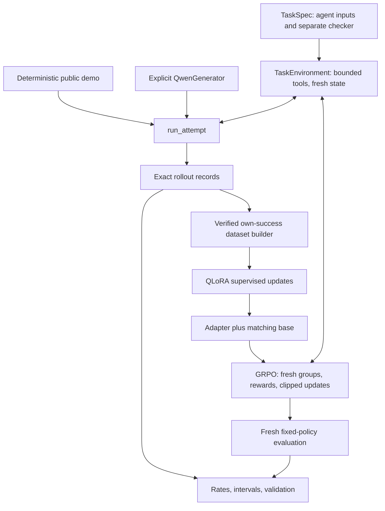

# Architecture

The package separates task state, model actions, data selection and parameter
updates. Its default synthetic path is CPU-only and does not import the GPU
stack.

## Components

| Module | Responsibility |
| --- | --- |
| `environment.py` | Load a task specification; expose agent inputs separately from scoring; validate tool calls; isolate attempt state |
| `rollouts.py` | Execute multi-turn episodes through the generator protocol; preserve actions, observations and outcomes |
| `modeling.py` | Configure/load Qwen explicitly; render native chat templates; parse calls; fingerprint model/tokenizer/configuration |
| `dataset.py` | Filter complete own successes, deduplicate exact targets and construct masked full-trajectory or action-only examples |
| `losses.py` | Select causal logit positions for assistant-token cross entropy without discarding context |
| `rsft.py` | Train QLoRA adapters and validate checkpoint continuation |
| `grpo.py` | Pure group-relative advantage, likelihood and clipped-objective calculations |
| `grpo_training.py` | Collect fresh online groups and update an existing adapter under declared GRPO settings |
| `analysis.py` | Summarize observations and check sanitized aggregate arithmetic |
| `cli.py` | Route explicit commands; keep help and CPU inspection usable without model loading |

## Interfaces and boundaries

`TaskSpec` provides an agent view containing instructions, inputs and tools.
Checker configuration remains evaluator-side. The public arithmetic task is
deliberately synthetic. A tool observation is appended as context; it is not
a sampled action and is excluded from training targets.

The generator protocol supplies configuration, metadata, `set_seed` and
`generate`. The real Qwen backend records native prompt and generated token
IDs. The deterministic demo uses an illustrative encoding and identifies
itself as a non-model demonstration.

Each episode receives fresh tool state. Bounded calculation accepts a limited
arithmetic expression rather than arbitrary host execution. Tool arguments
are data. Model output does not become a shell command.

The dataset boundary verifies source identity before accepting tokens. An
action-only example can reconstruct a different student prompt, but that
transformation and any collection assistance must remain explicit. The
trainer validates dataset/manifest/model bindings before allocating its model.

GRPO holds one group's behavior policy fixed while computing its saved old
probabilities and both inner updates. A later group is sampled using updated
weights. Equal-reward groups bypass the optimizer entirely. Final evaluation
is a separate operation with fixed settings and fresh seeds.

The public report consumes sanitized aggregates. It does not read private
inputs or infer private target provenance from a checksum. The
[reproducibility guide](reproducibility.md) explains those limits.
